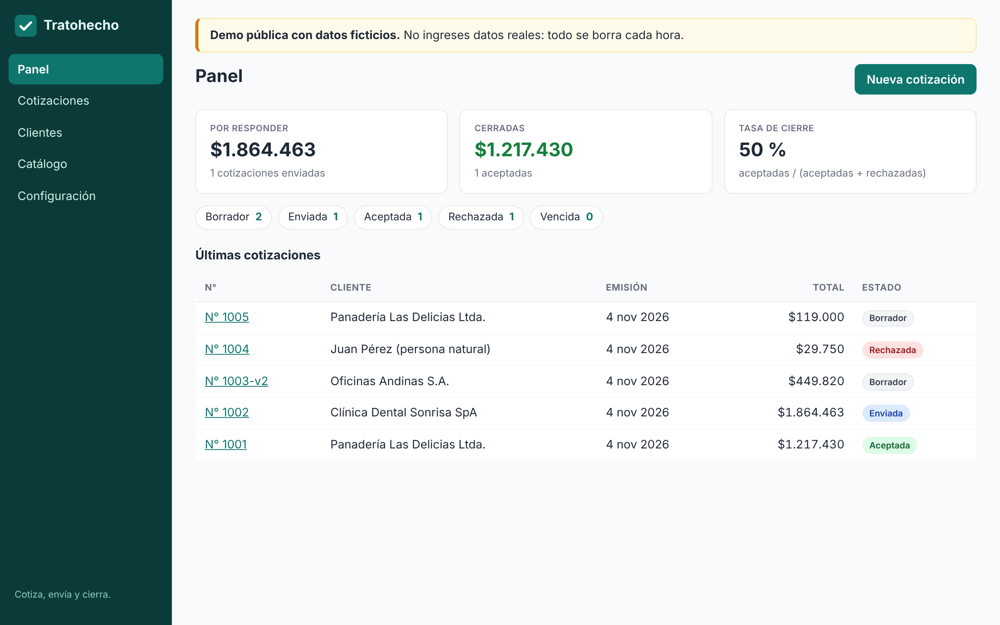
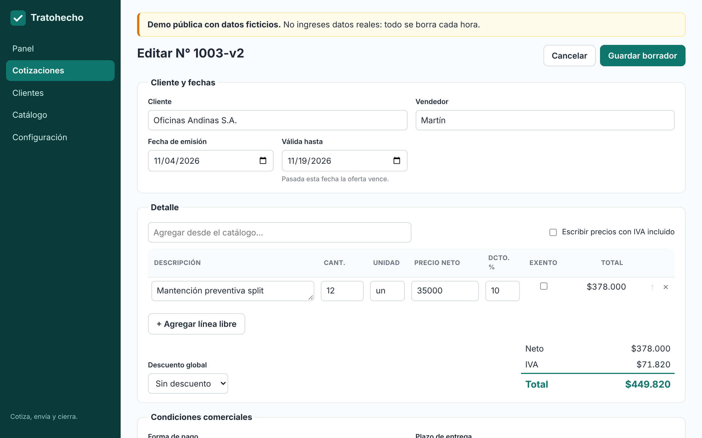
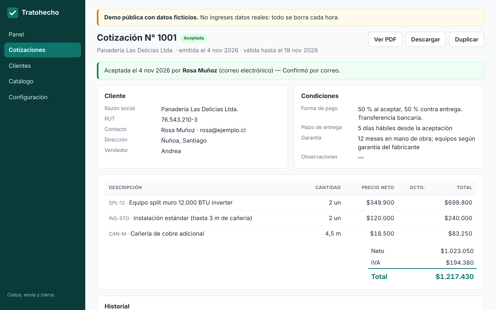
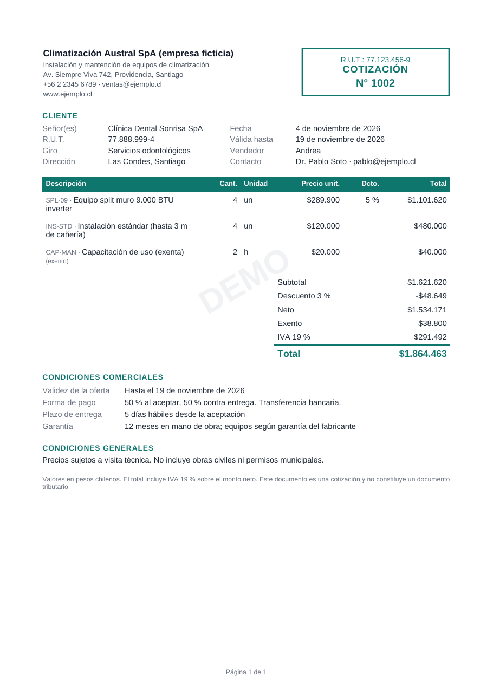
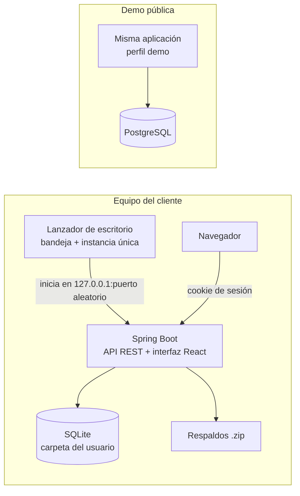

<p align="center"></p>

<h1 align="center">Tratohecho</h1>
<p align="center"><b>Cotiza, envía y cierra.</b> Cotizaciones profesionales para pymes chilenas, con pago único y tus datos en tu computador.</p>

<p align="center">
  
  
</p>

## Qué resuelve

Muchas pymes cotizan en Excel o Word: copian la última cotización, recalculan el IVA a mano, pierden el rastro de qué se envió y qué se aceptó. Las alternativas en Chile cobran mensualidad (de $9.990 a $24.990 al mes) o son generadores de PDF de un solo uso, sin historial.

Tratohecho es una **aplicación instalable** para Windows y macOS (también Linux) que se paga **una sola vez**:

- **Clientes y catálogo** reutilizables, con validación de RUT (módulo 11) y precios con o sin IVA.
- **Cotizaciones** con cantidades decimales, descuentos por línea y globales, ítems exentos e IVA calculado correctamente (sobre el total, no línea por línea).
- **PDF profesional** con tu logo, datos tributarios, condiciones comerciales y validez.
- **Seguimiento**: borrador → enviada → aceptada/rechazada/vencida, con historial y panel de tasa de cierre.
- **Versiones**: modificar una cotización enviada crea la versión N+1 (es una contraoferta) y la original queda intacta.
- **Respaldos** automáticos y restauración en un clic. Sin servidor, sin cuentas y sin telemetría.

<p align="center"> </p>

## Arquitectura



| Capa | Tecnología | Por qué |
|---|---|---|
| Dominio (`core/`) | Kotlin puro | Reglas de negocio sin framework; ArchUnit impide que dependa de Spring o JDBC |
| Aplicación (`app/`) | Spring Boot 4.1, Java 21 | API REST documentada con OpenAPI; errores en formato Problem Details (RFC 9457) |
| Persistencia | `JdbcClient` + SQL portable + Flyway | La **misma suite de pruebas** corre en SQLite (instalado) y en PostgreSQL (demo) |
| Interfaz (`frontend/`) | React 19, TypeScript, TanStack Query, React Hook Form + Zod | Se compila dentro del jar; el servidor es la única fuente de verdad de los totales |
| PDF | Thymeleaf (XHTML) → openhtmltopdf | Diseño con HTML/CSS; las pruebas leen el PDF con PDFBox |
| Escritorio (`desktop/`) | jpackage con el runtime de Java incluido | Instaladores .msi / .dmg / .deb generados en CI |
| Calidad | JUnit 6, kotest-property, Testcontainers, ArchUnit, ktlint, ESLint, Vitest, Playwright, CodeQL, Dependabot | |

Decisiones documentadas en [`docs/adr/`](docs/adr): base de datos dual, montos en pesos enteros, cálculo del IVA, seguridad del modo local, respaldos, licencias offline y entrega híbrida.

### Seguridad del modo instalado
La API escucha solo en `127.0.0.1`. El lanzador genera un token aleatorio por sesión, abre el navegador con `?t=<token>` y el servidor lo canjea por una cookie `HttpOnly; SameSite=Strict`. Además se valida el encabezado `Host` (contra DNS rebinding) y el `Origin` en escrituras, y se aplica una CSP sin `unsafe-eval`. Así, otras páginas abiertas en el navegador no pueden usar la API local. Detalles en el [ADR 0003](docs/adr/0003-seguridad-modo-local.md).

## Desarrollo

Requisitos: JDK 21, Node 22. Docker es opcional (solo para las pruebas contra PostgreSQL).

```bash
./gradlew check                      # ktlint + pruebas de dominio + integración SQLite/PostgreSQL + ArchUnit
```
```bash
./gradlew :app:bootRun -PsinFrontend --args='--spring.profiles.active=local,dev'   # API en :8080
```
```bash
cd frontend && npm ci && npm run dev  # interfaz en :5173 con proxy a la API
```
```bash
./gradlew :app:bootJar && cd e2e && npm ci && npx playwright test   # pruebas de punta a punta
```
```bash
./gradlew :desktop:empaquetar         # instalador del sistema operativo actual (msi, dmg o deb)
```
```bash
docker compose up --build             # demo con PostgreSQL en http://localhost:8080
```

### Publicar una versión
Crear la etiqueta `vX.Y.Z` y subirla: [`release.yml`](.github/workflows/release.yml) compila los instaladores en Windows, macOS y Linux, ejecuta una prueba de humo en cada uno y los adjunta a un GitHub Release con sus sumas SHA-256. La firma y notarización de macOS se activan al configurar los secretos `MAC_CERTIFICADO_P12`, `MAC_CERTIFICADO_CLAVE`, `MAC_FIRMA_IDENTIDAD`, `APPLE_ID`, `APPLE_TEAM_ID` y `APPLE_APP_PASSWORD`.

### Emitir licencias (vendedor)
Las licencias son textos firmados con Ed25519 que la app verifica sin conexión ([ADR 0006](docs/adr/0006-licencias.md)).
```bash
./gradlew :app:emitirLicencia --args="generar-claves"
```
```bash
TRATOHECHO_CLAVE_PRIVADA=... ./gradlew -q :app:emitirLicencia --args="emitir TH-0001 'Ferretería Los Andes SpA' INDIVIDUAL 76086428-5"
```
La clave pública incluida en `application.yml` es **de desarrollo**: genera tu propio par antes de vender y guarda la privada fuera del repositorio.

## Estructura
```
core/      dominio (RUT, cálculo, estados, versiones) y casos de uso
app/       API REST, persistencia, PDF, respaldos, licencias, seguridad, demo
frontend/  interfaz React
desktop/   lanzador de escritorio y empaquetado jpackage
e2e/       pruebas Playwright contra el jar real
docs/      ADR, validación comercial, auditoría de mercado y textos legales
```

## Estado
MVP vendible (v0.1). Próximo (v1.1): modo oficina multiusuario en red local, órdenes de trabajo, cotizaciones en UF/USD, importación de catálogo desde Excel y envío por correo. Ver [CHANGELOG](CHANGELOG.md).
